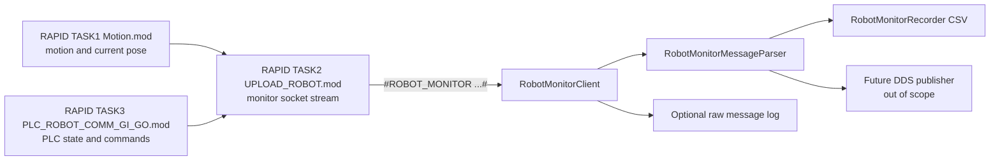

# AFP ABB C++ Slice K Design: Robot Monitoring Socket and RAPID Update

## Purpose

Slice K adds a lightweight ABB robot monitoring workflow to the C++ application. The goal is to confirm, with the real IRB4600 controller, that the PC can receive live robot pose and speed information from RAPID without changing the behavior of existing print, movement, PLC, camera, pressure, thermal camera, InfluxDB, or Grafana workflows.

This slice also brings the ABB RAPID controller backup into the C++ repository for controlled review. The original Python RAPID backup remains untouched.

## Source RAPID Copy

The RAPID backup was copied from:

```text
AFP_ABB_Python\rapid\4600.2_BACKUP_2026-03-10(receipt)
```

to:

```text
AFP_ABB_CPP\rapid
```

Only files under `AFP_ABB_CPP\rapid` may be edited. The Python backup folder must remain unchanged.

## Current Findings

The copied RAPID backup contains these key files:

- `RAPID\TASK1\PROGMOD\Motion.mod`: motion socket server on `serverPort := 5010`, `LOAD_MOD` handling, PLC-forward loop, motion command parsing, current pose/joint query cases, and buffered path execution.
- `RAPID\TASK2\PROGMOD\UPLOAD_ROBOT.mod`: upload/server socket on `UPLOADPort := 5012`, command forwarding from TASK1 to PC, ACK wait behavior, and many old commented telemetry procedures.
- `RAPID\TASK3\PROGMOD\PLC_ROBOT_COMM_GI_GO.mod`: PLC command/state exchange using GI/GO signals for start, pause, resume, stop, state, ACK, heartbeat, error, and progress.
- `HOME\testmod.mod`: sample AFP process program that calls metadata/process procedures and motion instructions.

The current C++ `RobotSocketClient` intentionally sends only the existing print side commands (`LOAD_MOD:<filename>#`, `PAUSE#`, `CONTINUE#`, `STOP#`) to the robot motion socket. It should not be expanded into a continuous monitor client, because that would mix command/ACK traffic with high-frequency telemetry.

## Scope

In scope:

- Add C++ robot monitoring classes that are separate from existing print and movement code.
- Add nested robot monitor configuration under `robot.monitor`.
- Start robot monitoring from configuration only, independent of `ConnectionRobotButton`.
- Receive robot monitor samples over a socket without blocking the Qt UI.
- Parse monitor messages into a typed C++ sample structure.
- Record parsed samples to CSV.
- Optionally record exact raw socket messages for diagnosis.
- Add minimal RAPID changes under copied `AFP_ABB_CPP\rapid`, focused on TASK1, TASK2, TASK3, and `HOME\testmod.mod`.
- Document RAPID cleanup recommendations, but keep cleanup edits conservative.

Out of scope for this slice:

- DDS publication of robot data.
- InfluxDB archive of robot data.
- Qt UI redesign or new live plotting widgets.
- Changing `ConnectionRobotButton` behavior.
- Replacing the existing robot print or PLC-forward movement services.
- Editing files under `AFP_ABB_Python`.

## Configuration

Robot monitoring should be nested under the existing `robot` tag to avoid duplicate user input:

```json
"robot": {
  "ip": "192.168.0.104",
  "port_motion": 5010,
  "transport": {
    "type": "plc"
  },
  "default_speed": {
    "tcp_linear": 200.0,
    "tcp_orientation": 200.0,
    "external_linear": 200.0,
    "external_orientation": 100.0
  },
  "monitor": {
    "enabled": true,
    "autostart": true,
    "port": 5012,
    "sample_interval_ms": 100,
    "record_csv": true,
    "record_raw_messages": true,
    "recording_dir": "logs/robot_monitor",
    "flush_every_sample": true
  }
}
```

`robot.ip` is shared by motion and monitoring. `robot.port_motion` remains the motion/print command socket. `robot.monitor.port` is the monitoring socket.

`robot.port_server` has been removed from the active C++ config because the monitor port now lives only under `robot.monitor.port`.

`flush_every_sample` means each CSV row and raw-message line is flushed to disk immediately after writing. This is recommended during hardware validation so test data survives crashes, disconnects, or forced exits. It can later be changed to `false` or replaced by a flush interval if disk write overhead becomes a concern.

## C++ Architecture

Add new files under a dedicated robot monitoring area, keeping the feature separate from existing robot print and movement code:

```text
src/robot_monitor/RobotMonitorSample.h
src/robot_monitor/RobotMonitorMessageParser.h
src/robot_monitor/RobotMonitorMessageParser.cpp
src/robot_monitor/RobotMonitorClient.h
src/robot_monitor/RobotMonitorClient.cpp
src/robot_monitor/RobotMonitorRecorder.h
src/robot_monitor/RobotMonitorRecorder.cpp
src/services/robot_monitor/RobotMonitoringService.h
src/services/robot_monitor/RobotMonitoringService.cpp
```

### `RobotMonitorSample`

Small value object for one monitor sample:

- PC receive timestamp.
- RAPID sequence number, if present.
- Cartesian TCP position: `x`, `y`, `z`.
- Orientation quaternion: `q1`, `q2`, `q3`, `q4`.
- Robot joints: `j1` through `j6`.
- External axis values where available.
- Commanded speed values where available.
- Estimated TCP speed calculated by C++ from consecutive samples.

### `RobotMonitorMessageParser`

Parses one framed RAPID text message into `RobotMonitorSample`. It should accept a simple key-value message format, reject malformed samples with a useful error string, and be covered by unit tests.

Example raw message:

```text
#ROBOT_MONITOR seq=12 x=100.20 y=50.10 z=300.00 q1=0.707 q2=0 q3=0 q4=0 j1=1.0 j2=2.0 j3=3.0 j4=4.0 j5=5.0 j6=6.0 speed_tcp=120.5#
```

The first RAPID implementation uses a compact form to keep the controller socket string short:

```text
#ROBOT_MONITOR s=12 x=100.2 y=50.1 z=300.0 v=120.5#
```

The parser strips the outer `#`, verifies the `ROBOT_MONITOR` prefix, parses key-value pairs, and reports missing/invalid numeric fields. The compact aliases are `s` for `seq` and `v` for `speed_tcp`. Orientation, joint, external-axis, and non-TCP speed fields are optional in this first proof; missing values are recorded as zero until RAPID is expanded to stream the fuller form.

### `RobotMonitorClient`

Owns the socket connection to `robot.ip:robot.monitor.port`.

Requirements:

- Use Qt networking and signals so the UI thread is not blocked.
- Reassemble messages by `#` frame delimiters because socket reads may split or combine messages.
- Emit raw messages and parsed samples separately.
- Report connection, disconnection, parse errors, and socket errors.
- Keep retrying connection attempts when the C++ application starts before the RAPID monitor socket is available.
- Report a tooltip-only warning when TCP connects but no monitor frames arrive.
- Do not send motion or print commands.
- Send only a lightweight `#ROBOT_MONITOR_CLIENT_ALIVE#` heartbeat so RAPID can detect stale accepted client sockets after the PC application is closed and restarted.
- Do not depend on `RobotSocketClient`.

### `RobotMonitorRecorder`

Records monitor output in:

```text
logs\robot_monitor
```

relative to the executable directory unless `robot.monitor.recording_dir` is absolute.

Outputs:

- Parsed CSV file: `robot_monitor_YYYYMMDD_HHMMSS.csv`
- Optional raw-message log: `robot_monitor_YYYYMMDD_HHMMSS.raw.log`

The raw log stores the exact text received from the RAPID socket before parsing. This is useful for diagnosing whether a problem came from RAPID formatting or C++ parsing.

### `RobotMonitoringService`

Qt-facing service created by `MainWindow`, similar to existing background services. It starts only when:

- `robot.monitor.enabled == true`
- `robot.monitor.autostart == true`

It should start from `MainWindow::startBackgroundServices()`, not from `ConnectionRobotButton`. This keeps robot monitoring independent and avoids changing the user-visible robot connection behavior.

For this slice, status is appended to the `robot_state_show` tooltip and written through Qt logging so it appears in `afp_abb_cpp.log`. The original UI design should not be changed.

## RAPID Design

Prefer using `TASK2\PROGMOD\UPLOAD_ROBOT.mod` as the monitoring socket task because it already owns `UPLOADPort := 5012` and socket send/receive behavior. `TASK1\PROGMOD\Motion.mod` remains responsible for motion and current pose/joint state. `TASK3\PROGMOD\PLC_ROBOT_COMM_GI_GO.mod` remains responsible for PLC command/state exchange.

The RAPID monitor stream should be small and deterministic:

- Send one `ROBOT_MONITOR` message every monitor-specific interval.
- Include sequence number.
- Include `CRobT(\Tool:=currentTool\WObj:=currentWobj)` Cartesian pose.
- Include currently commanded TCP speed when available.
- Keep each message one line and terminated by `#`.

The current copied `TASK2\PROGMOD\UPLOAD_ROBOT.mod` implementation sends the compact first-stage frame:

```text
#ROBOT_MONITOR s=<seq> x=<tcp_x> y=<tcp_y> z=<tcp_z> v=<currentSpeed.v_tcp>#
```

`monitor_wait_time:=0.1` should be kept synchronized with `robot.monitor.sample_interval_ms: 100` while validating hardware. The C++ side records the stream it receives; it does not currently send a command to change the RAPID sampling interval at runtime.

Joint, orientation, and external-axis values are intentionally left for a later expansion after the first Cartesian position/speed stream is confirmed on the real controller. This avoids adding a long RAPID string before the basic socket path is proven.

TASK2 must continue to support existing ACK behavior for AFP process command messages. Monitoring must not break `SocketReceive_Direct` expectations for `#COMMAND#` acknowledgements.

TASK2 now has a small reconnect path around the upload client socket:

- `AcceptUploadClient()` waits for a PC client on the existing server socket.
- `ReconnectUploadClient()` closes the old client socket and re-enters `SocketAccept`.
- `SendRobotMonitorMessage()` calls `ReconnectUploadClient()` if the client socket is no longer connected or if `SocketSend` fails.
- `CheckMonitorHeartbeat()` polls for `ROBOT_MONITOR_CLIENT_ALIVE` after the current monitor frame has already been sent. It polls every `monitor_heartbeat_poll_interval:=0.5` seconds by default and treats `monitor_heartbeat_timeout:=3.0` seconds without heartbeat as a stale PC client.

This handles the hardware case where `AFP_ABB_CPP.exe` is closed and then restarted while the RAPID program keeps running. Without this path, RAPID can keep the old client socket and the restarted C++ application may connect without receiving monitor frames.

Hardware testing also showed that `SocketGetStatus(clientSocket_upload)=SOCKET_CONNECTED` does not guarantee a later `SocketSend` will succeed. The PC client can close between the status check and the send. `SendRobotMonitorMessage()` therefore handles `ERR_SOCK_CLOSED` explicitly and finishes recovery with `TRYNEXT`, so TASK2 skips only the failed monitor sample instead of stopping on RobotStudio error `41595`.

The heartbeat receive is deliberately placed after `SendRobotMonitorMessage()` so the current sample is not delayed. The receive timeout is `0.001` s and is attempted only on heartbeat poll cycles, so the expected monitor stream latency impact is negligible compared with `monitor_wait_time:=0.1`.

If shared data between tasks is required, use existing `PERS` variables carefully. Avoid adding cross-task dependencies unless the controller accepts them cleanly in RobotStudio/real controller validation.

## RAPID Cleanup Recommendations

Cleanup should be conservative and reviewed separately from the first monitoring proof.

Recommended cleanup candidates:

- In `TASK2\PROGMOD\UPLOAD_ROBOT.mod`, remove old commented-out telemetry procedure copies once the new unified monitor sender is proven.
- In `TASK1\PROGMOD\Motion.mod`, reduce high-frequency `TPWrite` debug output around socket receive, `LOAD_MOD` parsing, and buffered motion cases after hardware tests pass.
- In `TASK3\PROGMOD\PLC_ROBOT_COMM_GI_GO.mod`, replace "stub/demo" comments with accurate comments once start/pause/resume/stop behavior is verified on the target controller.
- Keep `HOME\testmod.mod` as a sample AFP path program, but add comments or calls that demonstrate the monitoring workflow only if they are needed for robot-side validation.

Do not remove unknown RAPID modules or controller configuration files during this slice. Only recommend cleanup unless the dead code is clearly isolated and user-approved.

## Data Flow



## Future DDS and InfluxDB Extension

This slice should prepare, but not implement, DDS/InfluxDB robot archival. The clean extension point is the parsed `RobotMonitorSample`. A later slice can add:

```text
src/robot_monitor/RobotMonitorDdsTypes.h
src/robot_monitor/RobotMonitorDdsPublisher.h
src/robot_monitor/RobotMonitorDdsPublisher.cpp
src/archive/RobotMonitorSampleReader.h
```

Then the existing InfluxDB subscriber architecture can be extended with a robot monitor reader and line-protocol mapping. No RAPID message format change should be needed if `RobotMonitorSample` is designed well now.

## Error Handling

- If monitoring is disabled, no socket is opened and no warning is shown.
- If autostart is enabled but connection fails, report a clear non-fatal status message and retry in the background. The main GUI must still open normally.
- If TCP connects but no first frame arrives within a short interval, report a tooltip-only no-data status so hardware tests can distinguish "connected" from "receiving frames".
- If a raw message cannot be parsed, write it to the raw log when enabled and report a parse warning through status. Do not stop monitoring.
- If the socket disconnects, report status and retry the monitor connection while the service remains active.
- If CSV file creation fails, monitoring can continue with raw/status logging disabled for CSV and a clear warning.

## Testing and Verification

Unit tests:

- Parser accepts a valid `ROBOT_MONITOR` message.
- Parser rejects malformed prefix.
- Parser reports missing required fields.
- Parser handles multiple socket frames split by `#`.
- Recorder writes CSV header and one sample row.

Manual hardware test:

1. Configure `robot.ip` and `robot.monitor.port`.
2. Start the RAPID monitoring task on the ABB controller.
3. Start `AFP_ABB_CPP.exe`.
4. Confirm the GUI opens without waiting for the robot monitor socket.
5. Confirm CSV and optional raw log files are created under `logs\robot_monitor`.
6. Move the robot slowly and compare CSV pose values with the teach pendant.
7. Confirm `ConnectionRobotButton` behavior is unchanged.
8. Close and restart `AFP_ABB_CPP.exe` without stopping RAPID; confirm new CSV/raw files receive monitor data.
9. Start `AFP_ABB_CPP.exe` before RAPID; confirm the tooltip first reports a socket timeout/retry and then reports connection plus first frame after RAPID starts.

## Acceptance Criteria

- `AFP_ABB_Python` remains untouched.
- `AFP_ABB_CPP\rapid` contains the copied RAPID backup.
- Robot monitoring starts only from config and not from `ConnectionRobotButton`.
- The main GUI remains responsive even if the robot monitor socket is unavailable.
- Parsed robot monitor samples are recorded to CSV.
- Optional raw messages are recorded to a separate raw log.
- Existing robot print and PLC-forward movement tests still pass.
- README documents monitor config, CSV/raw log locations, RAPID file locations, and the future DDS/InfluxDB path.
